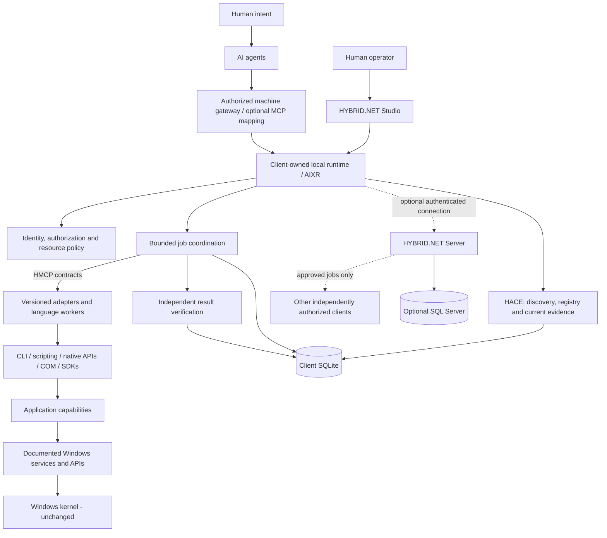
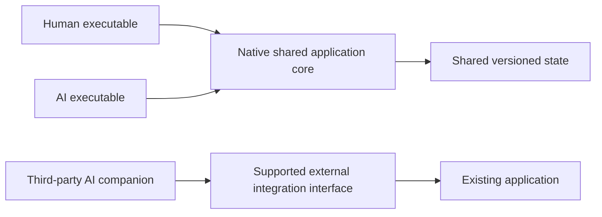

# HYBRID.NET architecture

Status: **PROPOSED ARCHITECTURE**, constrained by the accepted founding ADRs.
Genesis 1 contains no implementation of the components shown below. Design
version: 0.0.1; proposed HMCP contract version: 0.1 draft.

## System boundaries

The local client owns execution policy and remains operational when every remote
component is absent. The server is a coordinator, not an administrator of enrolled
machines. The first runtime is a user-space program: OS interoperability does not
imply drivers, kernel modification or universal access to application internals.

## Products and internal responsibilities

| Boundary | Proposed responsibility | Does not establish |
| --- | --- | --- |
| Client | Local identity, registry, jobs, evidence, recovery and optional gateway | Dependence on the central server |
| Server | Enrollment, distributed routing, authorized job state and evidence collection | Unrestricted remote execution or trusted results by assertion |
| HACE | Identify supported interfaces, register capability metadata/provenance, associate results with evidence | Universal understanding or access to arbitrary executables |
| HMCP | Language-independent capability contracts, invocation semantics, operation identity and structured results | A mandated transport or implemented protocol |
| AIXR | Invoke registered capabilities, supervise workers, manage lifecycles and controlled recovery | A replacement language VM, compiler or new project name |
| Adapter | Map supported application mechanisms to HMCP contracts and report limits | Access to undocumented internals of arbitrary executables |
| Studio | Human view and management of the same authorized runtime state | A second independent execution authority |
| Agent gateway | Translate requests into versioned, authorized capability invocations | Permission from natural-language intent alone |
| Verification | Evaluate explicit postconditions and preserve evidence | Proof from exit code or model confidence alone |

HACE, HMCP and AIXR are three logical subsystem responsibilities, not three required
processes or services. The [HACE lifecycle](docs/architecture/CAPABILITY-ENGINE.md)
spans discovery through verification, with work shared across those boundaries.
Verification is a component responsibility, not an additional named engine.

## Native applications and third-party bridges

The dual-executable pattern is a founding preference for new native applications.
Separate executables may share a service/core rather than load identical libraries;
the process boundary and concurrency model require a later ADR. An external adapter
must publish a narrower contract when only some operations or state are observable.
L0–L5 describe integration maturity, not authorization or guaranteed completeness.

## Operation and recovery semantics

Proposed sequence: discover a declared capability; check current availability;
authorize the exact operation and resources; validate input and version; persist
intent; dispatch with identity and deadline; collect events; verify postconditions;
persist a terminal result and evidence references. No ordinary deterministic
capability should require a model call merely to execute its defined operation.

Execution and verification are separate axes. A process may complete while its
output is invalid, and an output may exist after a timeout with an unknown remote
outcome. Cancellation requests are not confirmations of cancellation. On reconnect,
query durable job identity and reconcile evidence before deciding whether to retry.
An idempotency key is a deduplication mechanism only if its scope, storage and
adapter behavior are defined; it does not make every side effect exactly-once.

The [Independent Evidence Principle and proposed V0–V5 hierarchy](docs/architecture/INDEPENDENT-VERIFICATION.md)
define the evidence chain and provenance requirements. Execution reports, independent
observations, criterion evaluations and final conclusions remain distinct. V4 needs
predetermined criteria to pass; V5 requires a separate documented reproduction of
V4. Evidence strength must match consequences and known observation limits.

Shared human/AI state requires version checks, resource ownership and explicit
conflict outcomes. An agent must not overwrite a document changed by a person
after its observation. State may be stale or partially observable; include capture
time, source and limits rather than inventing inaccessible state.

## Trust and data boundaries

Provider authentication purchases or authorizes inference; client identity
authenticates a computer; API tokens authorize scoped framework operations.
These credentials are not interchangeable. A future loopback HTTP listener still
requires caller authentication and resource authorization. A named pipe requires
an explicit access policy; a local transport name alone is not isolation.

Application manifests, agent instructions, worker output and remote reports are
inputs to validate. Workers should execute with the least required authority.
Process limits, output bounds, path policy and evidence capture must be specified
before application adapters become verified capabilities. Strong OS containment
remains a later design and test decision, not a property of the diagrams.

SQLite and optional SQL Server share logical persistence contracts, not assumed
identical SQL dialects or transaction behavior. Local operational records remain
authoritative for local side effects; the server holds authorized projections and
remote workflow state. A durable outbox and reconciliation policy are candidates,
not implemented synchronization.

## Design navigation

- [Detailed overview](docs/architecture/SYSTEM-OVERVIEW.md), [standalone client](docs/architecture/STANDALONE-CLIENT.md), [distributed server](docs/architecture/DISTRIBUTED-SERVER.md), [hybrid mode](docs/architecture/HYBRID-MODE.md)
- [Multilanguage runtime](docs/architecture/MULTILANGUAGE-RUNTIME.md), [capability engine](docs/architecture/CAPABILITY-ENGINE.md), [state](docs/architecture/APPLICATION-STATE.md), [Windows interoperability](docs/architecture/WINDOWS-INTEROPERABILITY.md)
- [Protocol](docs/protocols/HMCP-CONCEPT.md), [IPC alternatives](docs/protocols/IPC-OPTIONS.md), [security](docs/security/API-KEY-ARCHITECTURE.md), [data model](docs/persistence/DATA-MODEL.md)
- [Initial ADRs](docs/decisions/ADR-0001-PROJECT-IDENTITY.md), [open questions](docs/research/TECHNICAL-QUESTIONS.md), [measurable milestones](ROADMAP.md)

The [Genesis 2 experiment](docs/genesis/GENESIS-2-EXPERIMENT.md) targets a deliberately
small local LibreOffice conversion, independent PDF verification and SQLite evidence.
Its ten acceptance criteria are specified before implementation. Neither this architecture nor
the existence of a draft message establishes operational compatibility, application
control, verified remote recovery or production readiness.
