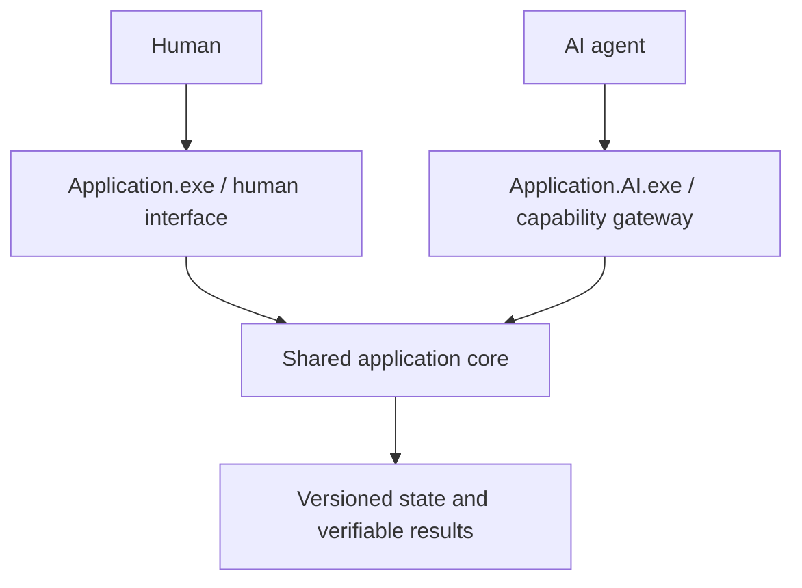

# HYBRID.NET

**Hybrid Native Execution and Interoperability Framework**

**GENESIS 1 · 0.0.1 · ARCHITECTURE FOUNDATION**

HYBRID.NET is a proposed AI-native framework through which agents can discover,
invoke, coordinate, observe and verify software capabilities across language
runtimes, Windows applications and authorized computers.

This repository preserves the founding architecture. It contains design documents,
eight architectural decisions, conceptual protocol examples, a measurable roadmap
and documentation validation tooling. **No HYBRID.NET runtime, application adapter,
client, server, installer or product executable has been implemented.** Windows
10/11 x64 and PowerShell 7 are the intended initial environment, not certifications.

## Why this project exists

Human interfaces present windows, menus and visual tools. Those interfaces are
valuable for people, but an agent should be able to request a supported document
export directly instead of reproducing a sequence of clicks. Direct interfaces
can expose explicit inputs, errors, state and verification evidence. They do not
eliminate authorization requirements or guarantee that a requested operation exists.

HYBRID.NET distinguishes CLI, scripting, API/SDK/COM/library integration and
graphical automation. A discovered executable is an application candidate; only
an adapter contract with current supporting evidence can establish an available
capability. Visual automation remains a labeled fallback.

## Two interfaces, one application core



This is the preferred design for newly created HYBRID.NET-native applications.
For existing third-party applications, a companion may instead adapt a documented
API, scripting system, command line or SDK. Naming a file `Photoshop.AI.exe` would
not grant access to Photoshop internals. These names are architectural examples,
not delivered executables or vendor endorsements. See the
[dual-executable concept](docs/vision/DUAL-EXECUTABLE-CONCEPT.md).

## Standalone first, distributed when authorized

The proposed **HYBRID.NET Client** owns local discovery, execution, verification,
credentials and SQLite persistence. It must work without a central server or an
internet connection for deterministic local operations. An installed local AI
backend may work offline; a remote AI provider requires its own connectivity.

The optional **HYBRID.NET Server** adds enrolled client discovery, distributed
scheduling and verification collection, with optional Microsoft SQL Server
persistence. It never replaces local execution authority. Disconnects must not
disable local work, and reconnection must not blindly replay an operation whose
side effects are uncertain. Hybrid mode selects suitable authorized local or
remote capabilities. See [architecture](ARCHITECTURE.md).

Proposed names are `Hybrid.Client.exe`, `Hybrid.Server.exe`,
`HYBRID-NET-CLIENT-SETUP.exe` and `HYBRID-NET-SERVER-SETUP.exe`. None exists yet.
**HYBRID.NET Studio** is the future human interface; its desktop technology is open.

## Common contracts across languages

**HMCP**, the proposed Hybrid Machine Capability Protocol, describes discovery,
registration, versioned operations, typed inputs/outputs, progress, cancellation,
errors, identity, state and verification. Transport bindings remain undecided.
JSON-RPC, stdio, local named pipes, gRPC/Protocol Buffers and WebSockets are
alternatives to evaluate, not one mandatory stack. MCP is an optional agent-facing
mapping, not a replacement for execution authorization or HMCP semantics.

| Candidate domain | Intended contribution |
| --- | --- |
| Go | Concurrent orchestration, communication and worker lifecycle |
| C++ | Documented native APIs, SDKs, DLL bridges and demanding processing |
| Java | JVM and enterprise application workers |
| JavaScript/TypeScript | Studio, browser adapters and developer clients |
| Python | AI adapters, scripting, diagnostics and transformations |
| C#/.NET | Managed Windows services, COM and native interop bridges |

These are design roles, not six implemented SDKs or six required installations.
**AIXR**, Artificial Intelligence Execution Runtime, is the internal runtime
concept. HYBRID.NET remains the project identity and is not a Microsoft product.

## Identity and persistence

AI provider credentials, client-to-server identity and scoped HYBRID.NET API
tokens are distinct authorities. Local API access is proposed as opt-in,
loopback-only and authenticated for protected capabilities. The example
`http://127.0.0.1:55001` is not a running endpoint. Windows DPAPI and Credential
Manager are candidates to assess; secrets must not enter logs or ordinary tables.

SQLite is the standalone client persistence direction. SQL Server is an optional
server direction behind explicit storage contracts. Execution events, capability
evidence and recovery checkpoints must survive restarts. No database server or
application is installed by this milestone.

## Start here

- [Founding vision](docs/vision/FOUNDING-VISION.md) and [mission traceability](docs/genesis/FOUNDING-TRACEABILITY.md)
- [Architecture](ARCHITECTURE.md), [current status](PROJECT_STATUS.md), [roadmap](ROADMAP.md)
- [HMCP proposal](docs/protocols/HMCP-CONCEPT.md), [technology alternatives](docs/research/TRADEOFFS.md)
- [Genesis scope](docs/genesis/GENESIS-1-SCOPE.md), [acceptance](docs/genesis/GENESIS-1-ACCEPTANCE.md), [report](docs/genesis/GENESIS-1-REPORT.md)
- [Contributor workflow](CONTRIBUTING.md) and [future agent instructions](AGENTS.md)

From PowerShell 7, validate repository documentation without installing any runtime:

```powershell
& I:\HYBRID-NET\scripts\validate-docs.ps1
```

This checks document integrity and conceptual JSON syntax. It does not test an
execution framework. Genesis 2 should prove two local processes exchanging one
synthetic capability and verification receipt before real application integration.
CFA, SCE, QASC/CLARA, CAE and POK remain optional neighboring projects; their code
and credentials are not imported here. License selection remains an open owner
decision; no license file has been added.
