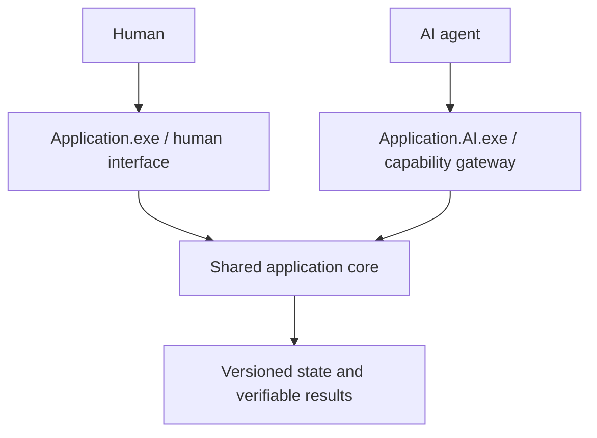

# HYBRID.NET

**Hybrid Native Execution and Interoperability Framework**

**GENESIS 2 · 0.1.0 · LOCAL EXECUTION PROTOTYPE**

HYBRID.NET is an AI-native framework project through which agents can discover,
invoke, coordinate, observe and verify software capabilities across language
runtimes, Windows applications and authorized computers.

Genesis 2 implements a narrow standalone execution path: `Hybrid.CLI.exe` discovers
registered capabilities, validates HMCP JSON, invokes LibreOffice without graphical
automation, runs independent Python verification and preserves SQLite evidence.
The final packaged experiment passed 33 acceptance checks: all six direct/framework
conversion trials met the ten frozen criteria, semantic reproduction reached V5,
and 11 injected faults produced no false V4. The automated regression suite passed
118 tests. See the [acceptance matrix](docs/genesis/GENESIS-2-ACCEPTANCE.md) and
[test report](docs/genesis/GENESIS-2-TEST-REPORT.md) for evidence and remaining gaps.

The [implementation guide](docs/genesis/GENESIS-2-IMPLEMENTATION.md) distinguishes
working components from remaining work. Genesis 1 and its eight founding ADRs remain
preserved; [ADR-0009](docs/decisions/ADR-0009-GENESIS-2-RUNTIME.md) records the first
runtime decisions. There is no server, Studio, installer, network API or MCP server.
This is an engineering prototype, not a production-ready platform.

## Run the implemented local path

Prerequisites are an available .NET SDK for building, LibreOffice, and the local
Python environment with [pinned verification dependencies](verification/requirements.txt).
The published `win-x64` bundle includes .NET; Python and LibreOffice remain external
dependencies. Keep the entire published directory, not just its `.exe`.

```powershell
& I:\HYBRID-NET\scripts\setup.ps1
& I:\HYBRID-NET\scripts\build.ps1
& I:\HYBRID-NET\scripts\test.ps1
$cli = 'I:\HYBRID-NET\.local\publish\win-x64\Hybrid.CLI.exe'
$python = 'I:\HYBRID-NET\.local\venv\Scripts\python.exe'
$workspace = 'I:\HYBRID-NET\.local\operator-workspace'
& $cli version
& $cli discover --workspace $workspace --python $python
& $cli capability document.export_pdf --workspace $workspace --python $python
```

Use the guide's [fixture and execution procedure](docs/genesis/GENESIS-2-IMPLEMENTATION.md)
for a new conversion. The actual CLI also provides `doctor`, `history`, `receipt`,
`verify`, `reproduce`, `execute --request`, `applications`, `capabilities` and
`inspect`. Every response is JSON. Query success is separate from a verified
operation; missing tools and incomplete observations remain explicit.

`text.normalize` is a second implemented adapter path for bounded UTF-8 without BOM,
NFC normalization and CRLF/CR-to-LF conversion with independent checks. The packaged
reuse experiment passed. Feasibility and reuse gates passed; engineering advantage
remains inconclusive. Mean wall time was 15.331 seconds directly and 20.086 seconds
through the framework in three trials each; human time savings are not established.

## Why this project exists

Human interfaces present windows, menus and visual tools. Those interfaces are
valuable for people, but an agent should be able to request a supported document
export directly instead of reproducing a sequence of clicks. Direct interfaces
can expose explicit inputs, errors, state and verification evidence. They do not
eliminate authorization requirements or guarantee that a requested operation exists.

HYBRID.NET distinguishes CLI, scripting, API/SDK/COM/library integration and
graphical automation. A discovered executable is an application candidate; only
an adapter contract with current supporting evidence can establish an available
capability. Visual automation remains a labeled fallback.

## Two interfaces, one application core



This is the preferred design for newly created HYBRID.NET-native applications.
For existing third-party applications, a companion may instead adapt a documented
API, scripting system, command line or SDK. Naming a file `Photoshop.AI.exe` would
not grant access to Photoshop internals. These names are architectural examples,
not delivered executables or vendor endorsements. See the
[dual-executable concept](docs/vision/DUAL-EXECUTABLE-CONCEPT.md).

## Standalone first, distributed when authorized

The standalone **HYBRID.NET Client** architecture owns local discovery, execution, verification,
credentials and SQLite persistence. It must work without a central server or an
internet connection for deterministic local operations. An installed local AI
backend may work offline; a remote AI provider requires its own connectivity.

The proposed optional **HYBRID.NET Server** adds enrolled client discovery, distributed
scheduling and verification collection, with optional Microsoft SQL Server
persistence. It never replaces local execution authority. Disconnects must not
disable local work, and reconnection must not blindly replay an operation whose
side effects are uncertain. Hybrid mode selects suitable authorized local or
remote capabilities. See [architecture](ARCHITECTURE.md).

Proposed names are `Hybrid.Client.exe`, `Hybrid.Server.exe`,
`HYBRID-NET-CLIENT-SETUP.exe` and `HYBRID-NET-SERVER-SETUP.exe`. None exists yet.
**HYBRID.NET Studio** is the future human interface; its desktop technology is open.

## Common contracts across languages

**HMCP**, the Hybrid Machine Capability Protocol, describes discovery,
registration, versioned operations, typed inputs/outputs, progress, cancellation,
errors, identity, state and verification. Genesis 2 implements validated local
JSON requests and receipts; wider transport bindings remain undecided.
The [implemented HMCP 0.1 contract](docs/protocols/HMCP-0.1.md) specifies the current
request, response, lifecycle and adapter semantics.
JSON-RPC, stdio, local named pipes, gRPC/Protocol Buffers and WebSockets are
alternatives to evaluate, not one mandatory stack. MCP is an optional agent-facing
mapping, not a replacement for execution authorization or HMCP semantics.

| Candidate domain | Intended contribution |
| --- | --- |
| Go | Concurrent orchestration, communication and worker lifecycle |
| C++ | Documented native APIs, SDKs, DLL bridges and demanding processing |
| Java | JVM and enterprise application workers |
| JavaScript/TypeScript | Studio, browser adapters and developer clients |
| Python | Implemented independent verification; future AI adapters, scripting and diagnostics |
| C#/.NET | Implemented local execution core; future managed services, COM and native bridges |

These are design roles, not six implemented SDKs or six required installations.
**AIXR**, Artificial Intelligence Execution Runtime, now has a narrow local
implementation. HYBRID.NET remains the project identity and is not a Microsoft product.

The architecture separates three logical responsibilities: **HACE**, Hybrid
Application Capability Engine, identifies supported capabilities and registers
their metadata and provenance; **HMCP** defines machine-readable contracts;
**AIXR** coordinates execution, workers and recovery. These are not three required
executables or services. See the [capability lifecycle](docs/architecture/CAPABILITY-ENGINE.md).

An adapter success response or exit code cannot establish fulfillment by itself.
The [Independent Evidence Principle](docs/architecture/INDEPENDENT-VERIFICATION.md)
separates reported execution, independent observation and predetermined acceptance
criteria. HYBRID.NET's V0–V5 vocabulary distinguishes a request from a verified result and
its separate reproduction. Artifact hashes identify bytes; they do not prove meaning.

## Identity and persistence

AI provider credentials, client-to-server identity and scoped HYBRID.NET API
tokens are distinct authorities. Local API access is proposed as opt-in,
loopback-only and authenticated for protected capabilities. The example
`http://127.0.0.1:55001` is not a running endpoint. Windows DPAPI and Credential
Manager are candidates to assess; secrets must not enter logs or ordinary tables.

SQLite is implemented locally for operations, events, immutable verification
records, capability registration and reproducibility links. Original receipts
remain separate from later re-verification. SQL Server remains a future optional
server direction; no database server is required or installed.

## Start here

- [Founding vision](docs/vision/FOUNDING-VISION.md) and [mission traceability](docs/genesis/FOUNDING-TRACEABILITY.md)
- [Architecture](ARCHITECTURE.md), [current status](PROJECT_STATUS.md), [roadmap](ROADMAP.md)
- [HMCP proposal](docs/protocols/HMCP-CONCEPT.md), [technology alternatives](docs/research/TRADEOFFS.md)
- [Genesis scope](docs/genesis/GENESIS-1-SCOPE.md), [acceptance](docs/genesis/GENESIS-1-ACCEPTANCE.md), [report](docs/genesis/GENESIS-1-REPORT.md)
- [Contributor workflow](CONTRIBUTING.md) and [future agent instructions](AGENTS.md)

From PowerShell 7, validate repository documentation:

```powershell
& I:\HYBRID-NET\scripts\validate-docs.ps1
```

This checks document integrity, founding coverage and JSON syntax. It does not
replace implementation or real-application tests. The frozen
[Genesis 2 experiment](docs/genesis/GENESIS-2-EXPERIMENT.md) and
[architectural addendum](docs/genesis/ARCHITECTURAL-ADDENDUM.md) remain historical
specifications; the implementation guide records the first actual evidence.
Windows 11 and clean-machine portability have not been tested. No working directory
or subprocess wrapper is claimed to provide an operating-system sandbox.
CFA, SCE, QASC/CLARA, CAE and POK remain optional neighboring projects; their code
and credentials are not imported here. License selection remains an open owner
decision; no license file has been added.
