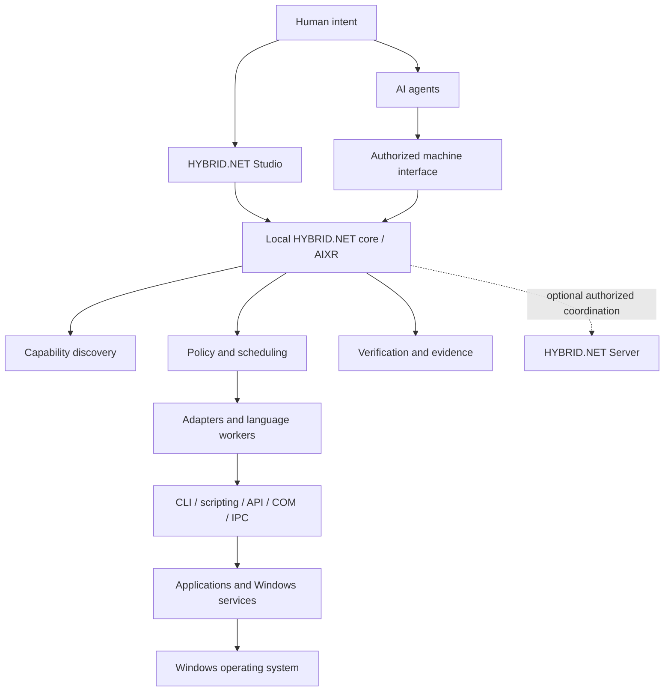

# System overview

**Status: PROPOSED ARCHITECTURE.** The boundaries below describe future components,
not installed services or verified capabilities.

The local client comprises a registry, execution coordinator, adapter/worker
boundary, verification engine, configuration and SQLite persistence. Studio and
agent integrations are consumers of shared runtime state. Optional server
connectivity is an extension; it must not appear on the critical path of local
execution.

Discovery identifies claims and current evidence. Policy authorizes the requested
operation and resources. Workers invoke supported application mechanisms. The
verification engine evaluates the result against declared criteria and retains
inputs, versions, outcome and evidence references. Process exit success alone is
insufficient for an artifact-producing task.

Adapters, agent-provided inputs, application outputs and remote clients are trust
boundaries. A registered manifest does not authorize arbitrary shell commands.
Identity, operation scope and resource scope require explicit checks at execution.
Code executing under the current user retains that user's privileges unless a
separately tested isolation backend constrains it.

Initial engineering stays in user space. The diagram's operating-system layer
expresses the normal dependency of applications on Windows; it does not require
kernel extensions, drivers or undocumented application introspection. Dependency
selection and capability implementation must remain independently testable.

See [standalone client](STANDALONE-CLIENT.md), [distributed server](DISTRIBUTED-SERVER.md)
and [HMCP](../protocols/HMCP-CONCEPT.md).
