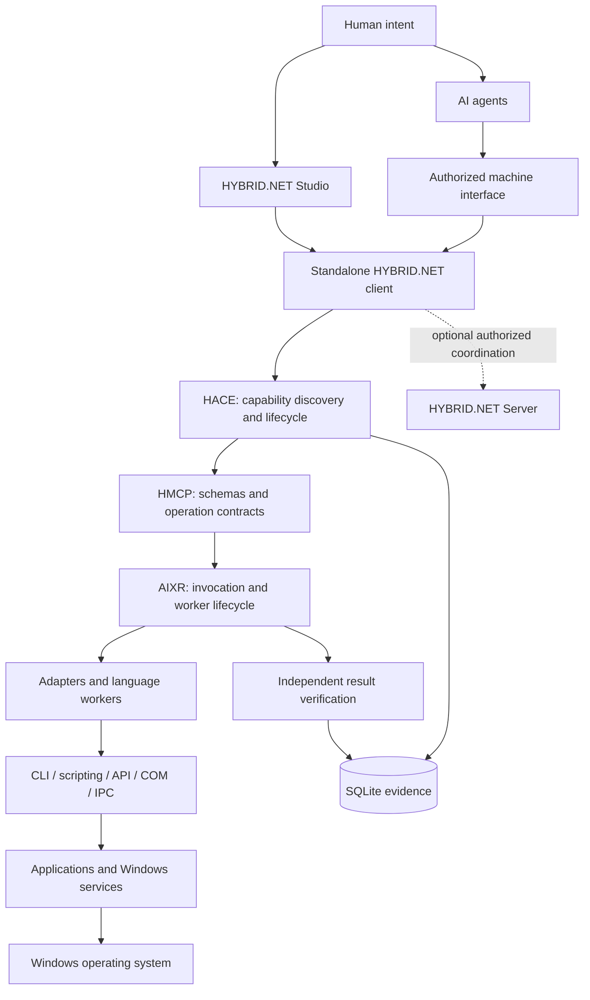

# System overview

**Status: PROPOSED ARCHITECTURE.** The boundaries below describe future components,
not installed services or verified capabilities.

The local client comprises a registry, execution coordinator, adapter/worker
boundary, independent verification, configuration and SQLite persistence. Studio and
agent integrations are consumers of shared runtime state. Optional server
connectivity is an extension; it must not appear on the critical path of local
execution.

[HACE](CAPABILITY-ENGINE.md) identifies capabilities and supported interfaces,
registers metadata/provenance and associates execution and verification evidence.
[HMCP](../protocols/HMCP-CONCEPT.md) supplies language/transport-independent schemas,
operation identities and structured results. [AIXR](../vision/AIXR-CONCEPT.md) invokes
workers, manages lifecycle and outcomes, and controls recovery. These are logical
responsibilities: the diagram does not require three executable processes or
services, and HMCP is not a mandatory running relay.

Policy authorizes the operation and resources before invocation. Workers use
supported application mechanisms. [Independent verification](INDEPENDENT-VERIFICATION.md)
evaluates fixed criteria and preserves evidence separately from execution outcome.
Process exit success alone is insufficient for an artifact-producing task.

Adapters, agent-provided inputs, application outputs and remote clients are trust
boundaries. A registered manifest does not authorize arbitrary shell commands.
Identity, operation scope and resource scope require explicit checks at execution.
Code executing under the current user retains that user's privileges unless a
separately tested isolation backend constrains it.

Initial engineering stays in user space. The diagram's operating-system layer
expresses the normal dependency of applications on Windows; it does not require
kernel extensions, drivers or undocumented application introspection. Dependency
selection and capability implementation must remain independently testable.

The preferred [Genesis 2 experiment](../genesis/GENESIS-2-EXPERIMENT.md) exercises
this boundary with local LibreOffice DOCX-to-PDF conversion, independent PDF parsing
and SQLite evidence. It must use supported non-GUI integration and need no central
server. This remains an architectural plan, not an implemented capability.

See [standalone client](STANDALONE-CLIENT.md), [distributed server](DISTRIBUTED-SERVER.md)
and [HMCP](../protocols/HMCP-CONCEPT.md).
