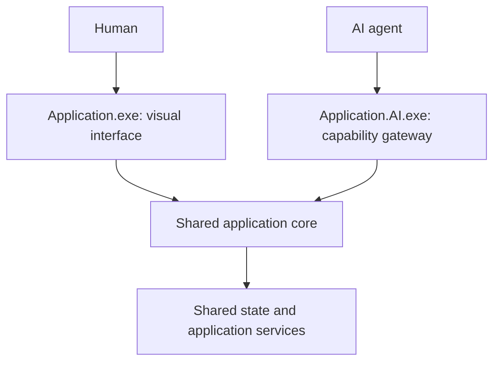

# Dual executable applications

**Status: VISION; preferred architecture for future HYBRID.NET-native applications.**
The names below are conceptual; Genesis 1 delivers no executables.

The human executable presents views, controls and interactive tools. Its AI
companion exposes capability discovery, structured invocation, state, progress,
errors and verification evidence. Both should address the same application model
and authorization rules. A second graphical front end would not fulfill the
machine-interface purpose.

The shared core is a logical requirement, not a finalized process topology. A core
service with two clients, a documented library used by both front ends, or an
existing application process with a supported gateway are alternatives. The design
must define ownership and concurrency before allowing both interfaces to modify
the same document. An expected state revision and conflict response are preferable
to silently overwriting a human edit.

For existing applications, a hypothetical `Photoshop.AI.exe` would be an adapter
using the vendor's supported integration surface. The example names express the
concept and imply neither vendor affiliation nor a working adapter. Naming or
launching a companion cannot reveal hidden functionality. Its manifest must state
which operations, versions and observation mechanisms are actually supported.

Future acceptance requires a human view and an agent operation to observe the
same state transition, reject a stale modification and produce matching evidence.
An adapter may implement only a subset of the application's functions. Read-only
discovery and state inspection must remain separately authorizable from writes.

See [application state](../architecture/APPLICATION-STATE.md).
